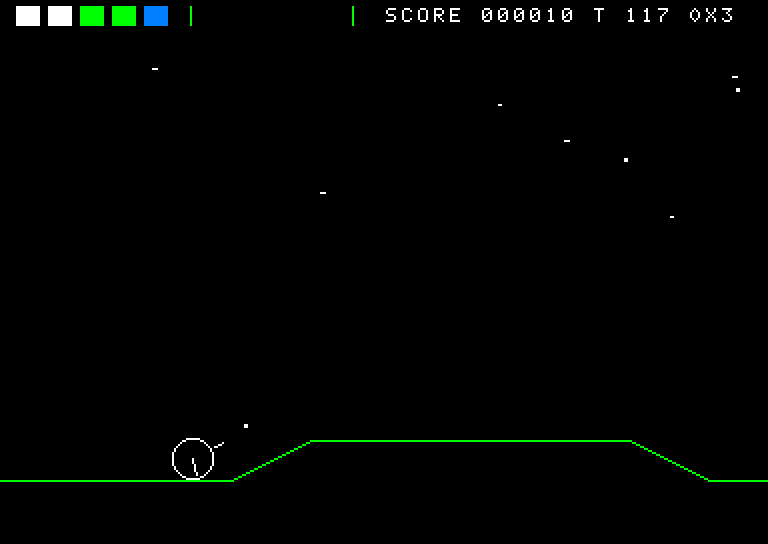
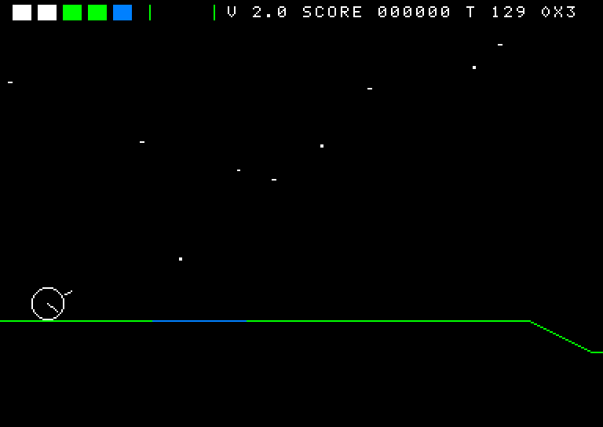

# LINNER — a pointless journey

*Roll fast. Shoot sharp. Stay well-rounded.*

A side-scrolling action game for the **Amstrad CPC** (464, 664 and 6128;
64K is enough), written in Z80 assembly. Linner is a circle with a
rebellious ray trapped inside him. He rolls along The Line, bending it into
hills and valleys, while the Bureau of Sharp Angles sends Rectangles,
Triangles, chasms and Water Lines to stop him.

The game runs at 50 frames per second in Mode 1 full overscan (384 × 272).
It uses a single screen buffer: everything is drawn with XOR, and only what
changed is redrawn. The loading screen and the menus show a vector world: a
sunset over wireframe mountains, and a floor that rolls towards you. In
the game, warp streaks rush through the sky at a multiple of Linner's
speed.

The AY chip plays the music and the sound effects, from the interrupt:
- a title theme;
- an in-game theme with bass, lead and drums, in a different key for each
  level;
- jingles for a level complete and for game over;
- effects for jumps, shots, hits, powerups, splashes, waypoints and crashes.

| | |
|:---:|:---:|
|  |  |
| The title screen and its Top 10 | Level 1, The Flat Line |
|  |  |
| Level 3, Water Lines | Level 5, Chasms: a jump over a gap |
|  |  |
| Phase Out: Linner as a ghost | Etching a name into the Top 10 |

## Manuals

- English: [docs/manual_en.md](docs/manual_en.md) · [PDF](docs/manual_en.pdf)
- Ελληνικά: [docs/manual_el.md](docs/manual_el.md) · [PDF](docs/manual_el.pdf)

## Playing

Build the game (see below), then:

- **Disc:** insert `build/linner.dsk` (Extended DSK) and type `RUN"DISC`.
  The high score table is saved on the disc, so keep it writable.
- **Snapshot:** load `build/linner.sna` into an emulator. It starts at the
  title screen, but it can't save high scores.

`make run` plays the snapshot in Caprice32, and `make run-dsk` boots the
disc. Add `EMU=cpcemu` to use CPCEMU instead.

### Controls

| Action | Keyboard | Joystick |
|---|---|---|
| Shift gear up / down (it also goes up by itself every 3 s) | RIGHT / LEFT | right / left |
| Aim the ray up / down | UP / DOWN | up / down |
| Jump (hold for a full jump) | SPACE | fire (either button) |

Linner shoots by himself; you choose where he aims.

### The rules in brief

- **Five gears, shifting up by themselves** every 3 seconds: from 1 to
  4.8 pixels a frame in gears 1–4. Gear 5 (7 pixels, twice the old top
  speed) is locked until you pick up the *Max Speed* Rhombus. LEFT and
  RIGHT shift by hand.
- **Gaps need speed.** A full jump carries Linner 40 px in gear 1 and
  280 px in gear 5; press jump again in the air for a second, half-strength
  jump. Falling into a gap costs a life.
- **Water Lines** slow Linner down and soak him. When the soggy bar is
  full, he sinks.
- **Rectangles, Triangles and spikes** take a life on contact. Linner's
  shots bring the foes down for points; he can't shoot downwards, so jump
  the Rectangles below him.
- **Rhombus powerups**, 3 to 8 seconds each: *Max Speed* opens gear 5,
  *Phase Out* turns Linner into a ghost that nothing but gaps can hurt.
- **The clock:** every level has a time limit. Each second left at the
  finish post is worth 10 points (8 on medium, 6 on easy).
- You have **3 lives**. Each level has 3 to 5 **waypoints**: a lost life
  restarts at the last one you passed.
- **Difficulty** (LEFT / RIGHT on the title): easy and medium run the whole
  world at 60% and 80% of hard's speed; every jump still lands in the same
  place, and the clock is longer to match.
- A Top 10 score lets you enter a 5-character name, which is saved on the
  disc with the difficulty's letter (E, M, H).

### The levels

| # | Name | Length | Time | What's waiting |
|---|---|---|---|---|
| 1 | The Flat Line | 12,012 px | 120 s | Gentle ground, the first foes, puddles and gaps |
| 2 | Swells | 12,904 px | 125 s | Rolling hills and plateaus, Triangles over the crests |
| 3 | Water Lines | 13,799 px | 135 s | The Bureau floods The Line: water and flooded valleys |
| 4 | The Bureau | 14,405 px | 140 s | Rectangles and Triangles everywhere, spikes in between |
| 5 | Chasms | 15,301 px | 95 s | Gaps and ledges for gears 3 and 4, and three chasms only Max Speed clears |
| 6 | End of the Line | 16,802 px | 105 s | Everything the Bureau has, three Max Speed chasms, and a tight clock |

## Building

You need:

- [rasm](https://github.com/EdouardBERGE/rasm), the Z80 assembler.
- [iDSK](https://github.com/cpcsdk/idsk), to build the disc image.
- Python 3, with Pillow for the screenshots.
- To play or test: Caprice32 (snap) or CPCEMU 2.5.

```bash
make
```

| Target | What it does |
|---|---|
| `make` | `build/linner.dsk` and `build/linner.sna` |
| `make run`, `make run-dsk` | play in Caprice32 (`EMU=cpcemu` for CPCEMU) |
| `make debug` | the border shows the frame time (red = drawing, blue = logic) |
| `make shot`, `make sim` | scripted demo in Caprice32 or in the Python Z80 simulator (`tools/cpcsim.py`) |
| `make hitest` | high score save and read-back on a real disc image |
| `make video` | `build/linner_video.mp4`: four minutes of the demo with its music, recorded in the simulator (needs ffmpeg) |
| `make screens` | the screenshots in `docs/screenshots/` |
| `make manuals` | the PDF manuals from `docs/manual_*.md` |
| `make release` | `build/release/linner-1.0.zip`: disc, snapshot, README, disc label and the PDF manuals |

The levels are plain text files in `levels/`. Each one starts with a
hand-made opening; `tools/levelgen.py` adds the rest, section by section in
the level's theme, and keeps only what passes the checks. `tools/level2asm.py`
turns them into compact data (2 bytes per stretch of ground, 2 or 3 per
foe). It fails the build if a level is unfair or too heavy for
the frame budget, for example:

- a gap that can't be jumped in any gear;
- foes standing over water;
- more objects on screen than there are slots;
- a screen predicted to take longer than a frame.

## Project layout

```
src/        Z80 sources (main.asm includes the rest)
levels/     level1.txt ... level6.txt
tools/      level compiler, table and music generators, Z80 simulator,
            video recorder, emulator scripts
docs/       manuals and screenshots
release/    README.txt and the disc label for the release zip
```

Design: [linner_game_story.md](linner_game_story.md), plan:
[milestones.md](milestones.md). Notes on the engine, the frame budget and
the tools: [CLAUDE.md](CLAUDE.md).
