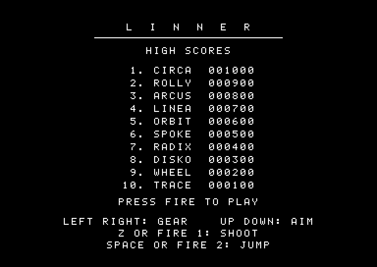
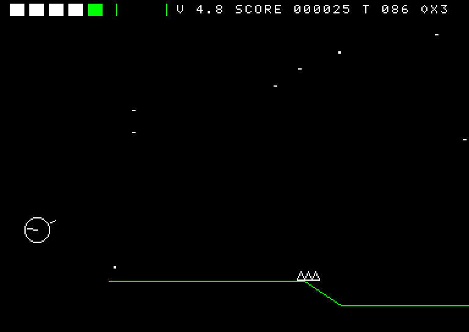
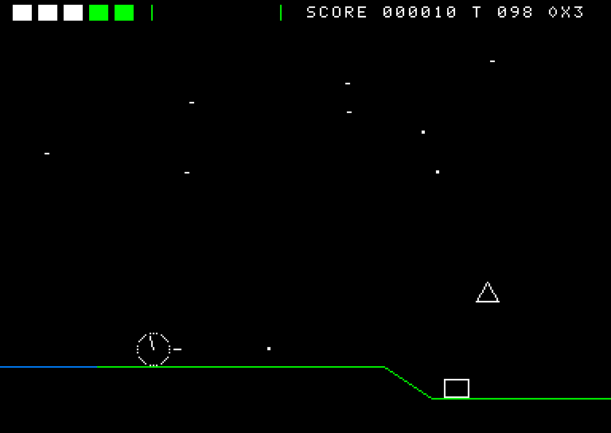
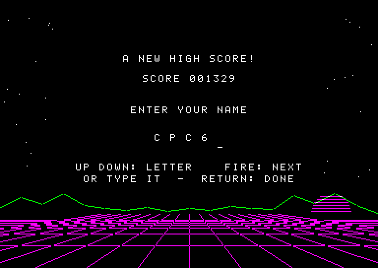

# LINNER — a pointless journey

*Roll fast. Shoot sharp. Stay well-rounded.*

A side-scrolling action game for the **Amstrad CPC** (464, 664 and 6128;
64K is enough), written in Z80 assembly. Linner is a circle with a
rebellious ray trapped inside him. He rolls along The Line, bending it into
hills and valleys, while the Bureau of Sharp Angles sends Rectangles,
Triangles, chasms and Water Lines to stop him.

The game runs at 50 frames per second in Mode 1 full overscan (384 × 272).
It uses a single screen buffer: everything is drawn with XOR, and only what
changed is redrawn.

| | |
|:---:|:---:|
|  |  |
| The title screen and its Top 10 | Level 1, The Flat Line |
|  |  |
| Level 3, Water Lines | Level 5, Chasms: a jump over a gap |
|  |  |
| Phase Out: Linner as a ghost | Etching a name into the Top 10 |

## Manuals

- English: [docs/manual_en.md](docs/manual_en.md) · [PDF](docs/manual_en.pdf)
- Ελληνικά: [docs/manual_el.md](docs/manual_el.md) · [PDF](docs/manual_el.pdf)

## Playing

Build the game (see below), then:

- **Disc:** insert `build/linner.dsk` and type `RUN"DISC`. The high score
  table is saved on the disc, so keep it writable.
- **Snapshot:** load `build/linner.sna` into an emulator. It starts at the
  title screen, but it can't save high scores.

`make run` plays the snapshot in Caprice32, and `make run-dsk` boots the
disc. Add `EMU=cpcemu` to use CPCEMU instead.

### Controls

| Action | Keyboard | Joystick |
|---|---|---|
| Shift gear up / down | RIGHT / LEFT | right / left |
| Aim the ray up / down | UP / DOWN | up / down |
| Shoot | Z | fire 1 |
| Jump (hold for a full jump) | SPACE | fire 2 |

### The rules in brief

- **Five gears.** Gears 1–4 go from 1 to 2.75 pixels a frame. Gear 5
  (3.5 pixels) is locked until you pick up the *Max Speed* Rhombus.
- **Gaps need speed.** A full jump carries Linner 40 px in gear 1 and
  140 px in gear 5. Falling into a gap costs a life.
- **Water Lines** slow Linner down and soak him. When the soggy bar is
  full, he sinks.
- **Rectangles, Triangles and spikes** take a life on contact. Shoot the
  foes for points; you can't shoot downwards, so jump the Rectangles below
  you.
- **Rhombus powerups:** *Max Speed* opens gear 5 for 20 seconds. *Phase
  Out* turns Linner into a ghost for 10 seconds, and nothing but gaps can
  hurt him.
- **The clock:** every level has a time limit. Each second left at the
  finish post is worth 10 points.
- You have **3 lives**. A Top 10 score lets you enter a 5-character name,
  which is saved on the disc.

### The levels

| # | Name | Time | What's waiting |
|---|---|---|---|
| 1 | The Flat Line | 60 s | Gentle ground, the first foes, puddles and three gaps |
| 2 | Swells | 55 s | Rolling hills, more Triangles, gaps that want gear 2 |
| 3 | Water Lines | 55 s | The Bureau floods the Line |
| 4 | The Bureau | 55 s | Little terrain, but twenty foes, with spikes in between |
| 5 | Chasms | 50 s | Chasms for gears 3 and 4, and the Great Chasm: Max Speed only |
| 6 | End of the Line | 45 s | Everything the Bureau has, and a tight clock |

## Building

You need:

- [rasm](https://github.com/EdouardBERGE/rasm), the Z80 assembler.
- [iDSK](https://github.com/cpcsdk/idsk), to build the disc image.
- Python 3, with Pillow for the screenshots.
- To play or test: Caprice32 (snap) or CPCEMU 2.5.

```bash
make
```

| Target | What it does |
|---|---|
| `make` | `build/linner.dsk` and `build/linner.sna` |
| `make run`, `make run-dsk` | play in Caprice32 (`EMU=cpcemu` for CPCEMU) |
| `make debug` | the border shows the frame time (red = drawing, blue = logic) |
| `make shot`, `make sim` | scripted demo in Caprice32 or in the Python Z80 simulator (`tools/cpcsim.py`) |
| `make hitest` | high score save and read-back on a real disc image |
| `make screens` | the screenshots in `docs/screenshots/` |
| `make manuals` | the PDF manuals from `docs/manual_*.md` |
| `make release` | `build/release/linner-1.0.zip`: disc, snapshot, README, disc label and the PDF manuals |

The levels are plain text files in `levels/`. `tools/level2asm.py` turns
them into data. It fails the build if a level is unfair or too heavy for
the frame budget, for example:

- a gap that can't be jumped in any gear;
- foes standing over water;
- more objects on screen than there are slots;
- a screen predicted to take longer than a frame.

## Project layout

```
src/        Z80 sources (main.asm includes the rest)
levels/     level1.txt ... level6.txt
tools/      level compiler, table generator, Z80 simulator, emulator scripts
docs/       manuals and screenshots
release/    README.txt and the disc label for the release zip
```

Design: [linner_game_story.md](linner_game_story.md), plan:
[milestones.md](milestones.md). Notes on the engine, the frame budget and
the tools: [CLAUDE.md](CLAUDE.md).
