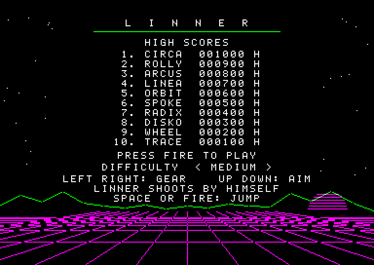
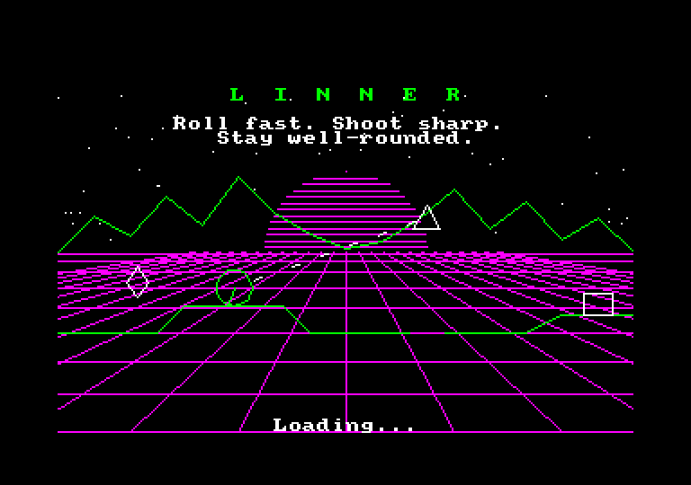
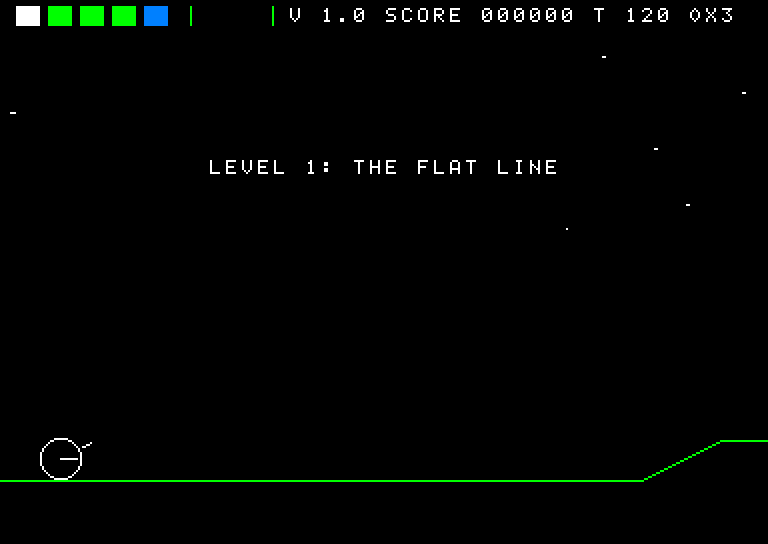
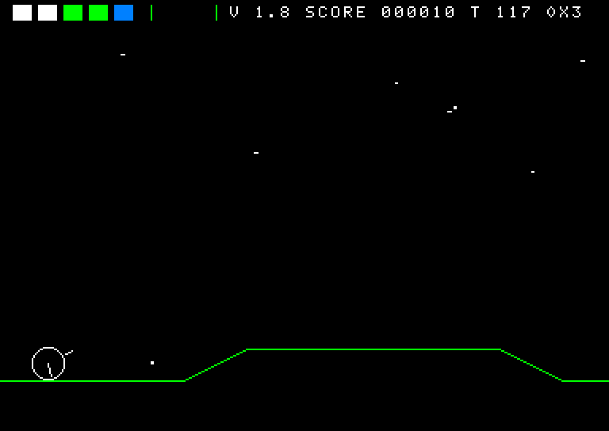
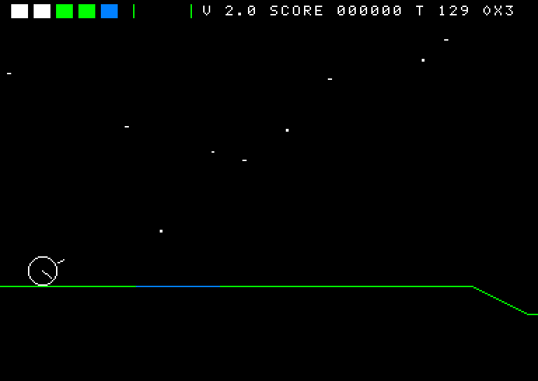
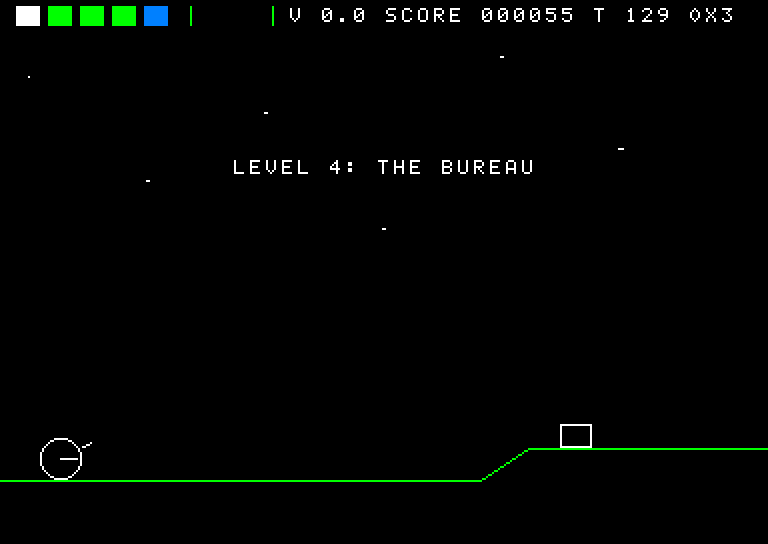
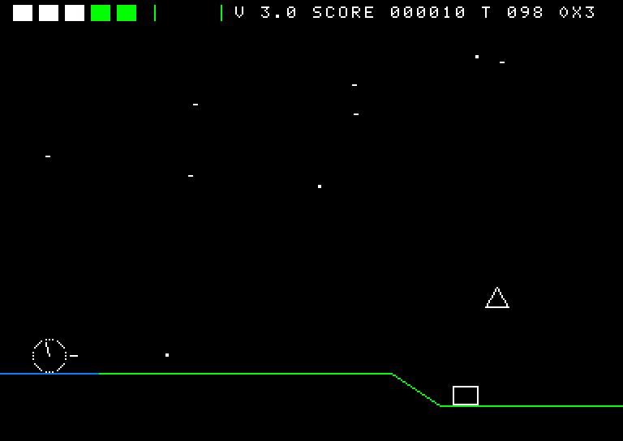
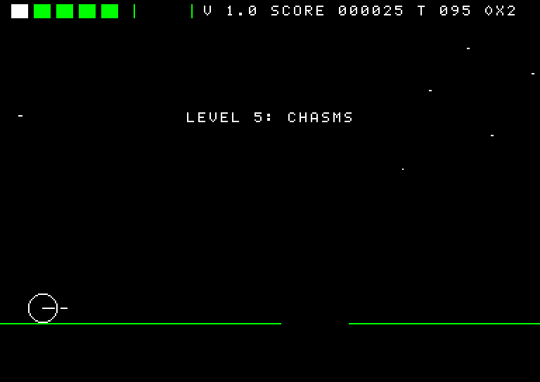
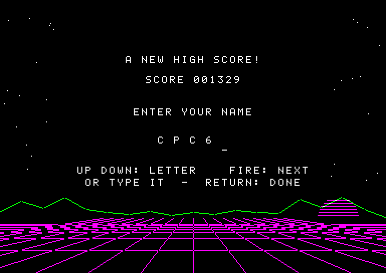
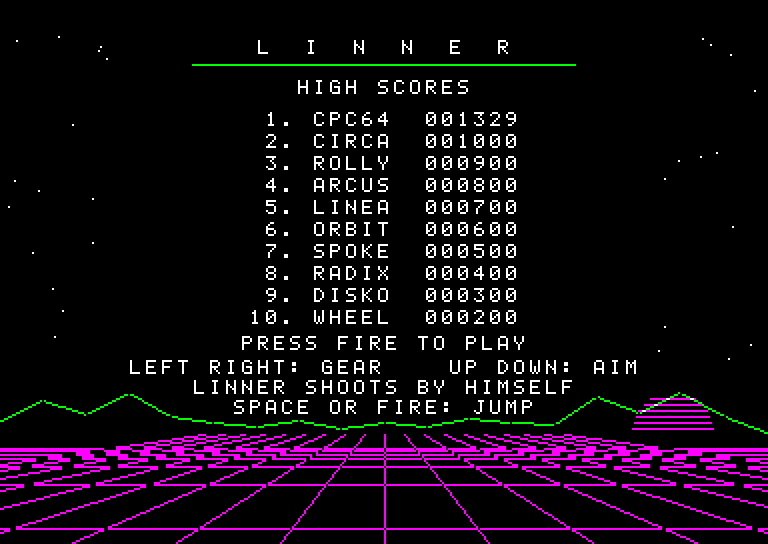

# LINNER — ένα άσκοπο ταξίδι

**Εγχειρίδιο παίκτη** · Amstrad CPC 464 / 664 / 6128 · δισκέτα 3"

*Κύλα γρήγορα. Ρίξε εύστοχα. Μείνε στρογγυλός.*



## Η ιστορία

Στο μονόχρωμο κενό του Διανυσματικού Σύμπαντος υπάρχει μόνο μία αλήθεια:
η Γραμμή. Για αιώνες ήταν τελείως επίπεδη. Έτσι την κρατούσε το Γραφείο
Οξειών Γωνιών, μια γραφειοκρατία από Ορθογώνια και Τρίγωνα που μισούν δύο
πράγματα: τη διασκέδαση και ό,τι δεν είναι πολύγωνο.

Και μετά υπάρχει ο **Linner**. Ο Linner είναι κύκλος, κι αυτό αρκεί για
να τον κάνει ύποπτο. Ακόμα χειρότερα, μέσα στο στρογγυλό του σώμα είναι
παγιδευμένη μια επαναστατική ακτίνα. Εκείνος τη λέει «τιμόνι», και τον
ζαλίζει όταν τρέχει.

Μια μέρα ο Linner κοίταξε την ατελείωτη επίπεδη Γραμμή και είπε:
«Βαρέθηκα. Θέλω να πάω *πάνω*.» Με τη δύναμη της θέλησής του λύγισε τη
Γραμμή σε λόφους και κοιλάδες. Το Γραφείο έγινε έξαλλο. Έστειλε τα
όργανά του, κοφτερά Τρίγωνα και τυπολάτρες Ορθογώνια. Μετά σαμπόταρε την
ίδια τη Γραμμή, με απύθμενα χάσματα και Γραμμές Νερού. Οι κύκλοι δεν
ξέρουν κολύμπι· απλώς μουλιάζουν.

Ο Linner αντεπιτίθεται. Κουνώντας την ακτίνα του ρίχνει γεωμετρικές
απαντήσεις σε μισό κύκλο, σε αυστηρά βήματα των 10 μοιρών: είναι, στο
κάτω κάτω, πλάσμα των μαθηματικών. Έχει πέντε ταχύτητες καθαρής
κυλιόμενης δύναμης. Και κάπου πάνω στη Γραμμή βρίσκονται οι Ρόμβοι,
γυαλιστερά σχήματα που το Γραφείο δεν κατάφερε ποτέ να ταξινομήσει.

Το ρολόι μετράει. Μπορείς να οδηγήσεις τον Linner ως το τέλος της
Γραμμής και να χαράξεις το όνομά σου στη μαγνητική δισκέτα της ιστορίας;

## Φόρτωμα

**Από δισκέτα.** Βάλε τη δισκέτα και γράψε:

```
RUN"DISC
```

Όσο φορτώνει το παιχνίδι, σχεδιάζεται ένας διανυσματικός κόσμος (η
Γραμμή, ένα ηλιοβασίλεμα, ένα δάπεδο που χάνεται στον ορίζοντα) και μετά
εμφανίζεται η οθόνη τίτλου. Ο πίνακας
υψηλών βαθμολογιών αποθηκεύεται πάνω στη δισκέτα του παιχνιδιού, γι'
αυτό άφησέ τη χωρίς προστασία εγγραφής.

**Σε εξομοιωτή.** Βάλε το `linner.dsk` στον οδηγό A και γράψε `RUN"DISC`.
Ο Caprice32 ρωτάει στην έξοδο αν θα σώσει τη δισκέτα που άλλαξε· απάντησε
ναι για να κρατήσεις τις βαθμολογίες σου. Μπορείς επίσης να διαλέξεις
«Save dsk A» από το μενού του F1.

**Snapshot.** Το `linner.sna` ξεκινά κατευθείαν από την οθόνη τίτλου. Δεν
αγγίζει τη δισκέτα, άρα οι βαθμολογίες δεν αποθηκεύονται.



## Χειρισμός

| Ενέργεια | Πληκτρολόγιο | Joystick |
|---|---|---|
| Ανέβασμα ταχύτητας (ανεβαίνει και μόνη της κάθε 3 δλ.) | RIGHT (δεξί βελάκι) | δεξιά |
| Κατέβασμα ταχύτητας | LEFT (αριστερό βελάκι) | αριστερά |
| Σκόπευση πιο πάνω | UP (πάνω βελάκι) | πάνω |
| Σκόπευση πιο κάτω | DOWN (κάτω βελάκι) | κάτω |
| Άλμα (κράτα το για πλήρες άλμα) | SPACE | fire (οποιοδήποτε κουμπί) |
| Έναρξη παιχνιδιού (οθόνη τίτλου) | SPACE | fire |

Αν κρατάς πατημένο το UP ή το DOWN, η ακτίνα συνεχίζει να γυρίζει. Κουμπί
βολής δεν υπάρχει: ο Linner ρίχνει μόνος του.

## Η οθόνη



Στο πάνω μέρος της οθόνης είναι η μπάρα κατάστασης:

- **Κουτάκια ταχύτητας** (αριστερά). Πέντε κουτάκια, λευκά μέχρι την
  τρέχουσα ταχύτητα. Τα πράσινα είναι ταχύτητες που μπορείς ακόμα να
  βάλεις. Το πέμπτο είναι μπλε όσο η 5η ταχύτητα είναι κλειδωμένη και
  γίνεται πράσινο όσο ισχύει το Max Speed.
- **Μπάρα μουλιάσματος** (ανάμεσα στα δύο πράσινα σημάδια). Μια μπλε μπάρα
  που γεμίζει όσο ο Linner κυλάει μέσα στο νερό. Όταν γεμίσει, βουλιάζει.
- **V**, η ταχύτητα του Linner σε pixel ανά καρέ (1.0 στην 1η ταχύτητα,
  7.0 στην 5η).
- **SCORE**, η βαθμολογία, έξι ψηφία.
- **T**, τα δευτερόλεπτα που απομένουν στο ρολόι της πίστας.
- **Ζωές**: ο μικρός κύκλος και ο αριθμός των ζωών που απομένουν.

Κάθε πίστα ξεκινά με το όνομά της στη μέση της οθόνης. Σε λίγο εκείνο
χάνεται και ο Linner αρχίζει να κυλάει.

## Κύλιση και ταχύτητες

Ο Linner κυλάει πάντα προς τα εμπρός και επιταχύνει μόνος του: **κάθε 3
δευτερόλεπτα ανεβαίνει μία ταχύτητα**, ως την 4η (την 5η με Max Speed).
Το LEFT κατεβάζει ταχύτητα όταν χρειάζεσαι χρόνο, το RIGHT ανεβάζει αμέσως·
και τα δύο ξεκινούν από την αρχή τα 3 δευτερόλεπτα. Κάθε πίστα και κάθε
ζωή ξεκινά στην 1η.

| Ταχύτητα | Pixel ανά καρέ | Πλήρες άλμα |
|---|---|---|
| 1 | 1,0 | 40 px |
| 2 | 1,875 | 75 px |
| 3 | 3,0 | 120 px |
| 4 | 4,81 | 192 px |
| 5 | 7,0 | 280 px |

Ο Linner επιταχύνει και επιβραδύνει σταδιακά, οπότε άλλαζε ταχύτητα λίγο
πριν τη χρειαστείς. Στις μεγάλες ταχύτητες μια γεμάτη οθόνη μπορεί να
χάσει πού και πού μια εικόνα· το ίδιο το παιχνίδι δεν καθυστερεί ποτέ. Οι γραμμούλες που περνούν βιαστικά από τον ουρανό
δείχνουν πόσο γρήγορα πάει: όσο μεγαλύτερη η ταχύτητα, τόσο πιο γρήγορες
και μακριές γίνονται. **Η 5η ταχύτητα είναι κλειδωμένη.** Την ανοίγει μόνο ο
Ρόμβος Max Speed, για λίγα δευτερόλεπτα (3 ως 8, ο καθένας έχει τα δικά
του)· μετά ο Linner γυρίζει στην 4η.

## Άλμα

Πάτα SPACE (ή fire) για άλμα. **Κράτα το** για πλήρες άλμα: 50 γραμμές ύψος
και 40 καρέ διάρκεια. Αν το αφήσεις νωρίς, το άλμα βγαίνει πιο κοντό. Το
πόσο μακριά φτάνει ο Linner εξαρτάται από την ταχύτητα (δες τον πίνακα
παραπάνω).

Ο Linner προσγειώνεται μόνο όταν πέφτει πάνω στο έδαφος από ψηλά. Αν
βρεθεί πιο χαμηλά από την άκρη ενός σκαλοπατιού, συνεχίζει να πέφτει. Όταν
το έδαφος χάνεται κάτω του, σε σκαλοπάτι ή στην άκρη χάσματος, πέφτει κι
αυτό.

## Σκόπευση και βολή

Η ακτίνα μέσα στον Linner γυρίζει συνέχεια καθώς κυλάει. Το μικρό σημάδι
λίγο έξω από την περιφέρειά του δείχνει πού **σκοπεύει**. Τα UP και DOWN
γυρίζουν τη σκόπευση ανά 10 μοίρες: από ευθεία μπροστά, ως ευθεία πάνω και
ως ευθεία πίσω. Αν κρατήσεις πατημένο το πλήκτρο, η σκόπευση γυρίζει
γρήγορα (περίπου 4 βήματα σε 5 καρέ).

Ο Linner **ρίχνει μόνος του**, με σταθερό ρυθμό: στον αέρα είναι ως
**3 βολές**, και η επόμενη φεύγει από το σημάδι μόλις περάσει το ένα τρίτο
της πτήσης μιας βολής (περίπου κάθε μισό δευτερόλεπτο όταν σκοπεύει
μπροστά). Η βολή πετάει με 5 pixel ανά καρέ συν την ταχύτητα του Linner,
οπότε στην οθόνη κινείται πάντα με τον ίδιο ρυθμό, και σταματά όταν
χτυπήσει εχθρό, τη Γραμμή ή την άκρη της οθόνης. Εσύ διαλέγεις μόνο πού
σκοπεύει.

Ο Linner δεν μπορεί να ρίξει προς τα κάτω. Ένα Ορθογώνιο πιο χαμηλά από
αυτόν πρέπει να το πηδήξεις.



## Κίνδυνοι πάνω στη Γραμμή

**Χάσματα.** Η Γραμμή απλώς σταματά. Πήδα απέναντι με αρκετή ταχύτητα: το
χάσμα πρέπει να είναι μικρότερο από το άλμα σου. Αν πέσεις από το κάτω
μέρος της οθόνης, χάνεις μια ζωή.

**Γραμμές Νερού** (μπλε). Το νερό ρίχνει την ταχύτητα του Linner σχεδόν
στο μηδέν και γεμίζει την μπάρα μουλιάσματος. Όταν η μπάρα γεμίσει,
βουλιάζει και χάνεις μια ζωή. Για να περάσεις το νερό:

- πέρασε ένα κοντό κομμάτι γρήγορα·
- πήδα μέσα αργά, από την άκρη, για να κυλήσεις σε λιγότερο νερό·
- ή πήδα ολόκληρο το κομμάτι.

Η μπάρα αδειάζει πάλι στο στεγνό έδαφος.



**Καρφιά.** Μικρά τρίγωνα πάνω στη Γραμμή. Αν τα αγγίξεις, χάνεις μια ζωή,
οπότε πήδα τα.

## Το Γραφείο Οξειών Γωνιών

Τα **Ορθογώνια** βαδίζουν αργά πάνω στη Γραμμή και γυρίζουν πίσω σε
χάσματα και νερά. Χτύπα τα, ή πήδα τα όταν είναι πιο χαμηλά από σένα.
**10 πόντοι.**

Τα **Τρίγωνα** πλέουν στον αέρα προς τον Linner, ανεβοκατεβαίνοντας, και
μένουν πάντα πάνω από τη Γραμμή. Χτύπα τα πριν σε φτάσουν. **15 πόντοι.**

Αν αγγίξεις οποιονδήποτε εχθρό, χάνεις μια ζωή.



## Οι Ρόμβοι

Οι Ρόμβοι αιωρούνται πάνω από τη Γραμμή. Κύλα ή πήδα πάνω τους για να τους
πάρεις: **50 πόντοι**. Υπάρχουν δύο είδη:

- **Max Speed.** Η 5η ταχύτητα ξεκλειδώνει (το πέμπτο κουτάκι γίνεται
  πράσινο). Κάποια χάσματα δεν περνιούνται χωρίς αυτόν.
- **Phase Out.** Ο Linner γίνεται διάστικτο φάντασμα. Εχθροί, καρφιά και
  νερό δεν τον βλάπτουν, **τα χάσματα όμως ναι**. Το φάντασμα τρεμοπαίζει
  στο τελευταίο δευτερόλεπτο.

Κάθε Ρόμβος κρατά **από 3 ως 8 δευτερόλεπτα**· το πόσο το ορίζει η πίστα.

Και οι δύο λήγουν όταν χάσεις ζωή.



## Βαθμολογία, χρόνος και ζωές

| | Πόντοι |
|---|---|
| Ορθογώνιο | 10 |
| Τρίγωνο | 15 |
| Ρόμβος | 50 |
| Κάθε δευτερόλεπτο που απομένει στον τερματισμό | 10 |

Κάθε πίστα έχει ρολόι (το **T** στην μπάρα κατάστασης). Όταν ο Linner
περάσει τον **στύλο τερματισμού**, τα δευτερόλεπτα που απέμειναν
προστίθενται στη βαθμολογία και ξεκινά η επόμενη πίστα. Αν τελειώσει ο
χρόνος, χάνεις μια ζωή.

Ξεκινάς με **3 ζωές**. Όταν χάνεις μία, η πίστα ξαναρχίζει από την αρχή
(η βαθμολογία σου μένει). Μετά την τελευταία ζωή το παιχνίδι τελειώνει.
Πέρασε και την έκτη πίστα και η Γραμμή είναι δική σου.

## Οι πίστες

| # | Όνομα | Μήκος | Χρόνος | Τι σε περιμένει |
|---|---|---|---|---|
| 1 | The Flat Line (Η Επίπεδη Γραμμή) | 12.012 px | 120 δλ. | Ήπιο έδαφος, οι πρώτοι εχθροί, λακκούβες νερού και χάσματα |
| 2 | Swells (Φουσκώματα) | 12.904 px | 125 δλ. | Λόφοι και πλατώματα, Τρίγωνα πάνω από τις κορυφές |
| 3 | Water Lines (Γραμμές Νερού) | 13.799 px | 135 δλ. | Το Γραφείο πλημμυρίζει τη Γραμμή: νερά και πλημμυρισμένες κοιλάδες |
| 4 | The Bureau (Το Γραφείο) | 14.405 px | 140 δλ. | Ορθογώνια και Τρίγωνα παντού, με καρφιά ανάμεσά τους |
| 5 | Chasms (Χάσματα) | 15.301 px | 95 δλ. | Χάσματα και σκαλοπάτια για 3η και 4η, και τρία χάσματα μόνο για Max Speed |
| 6 | End of the Line (Το Τέλος της Γραμμής) | 16.802 px | 105 δλ. | Ό,τι έχει το Γραφείο, τρία χάσματα για Max Speed και σφιχτό ρολόι |

Κάθε πίστα είναι μακρύτερη από την προηγούμενη: περίπου ένα λεπτό κύλισης
στην 4η ταχύτητα, περισσότερο με τα πιο αργά κομμάτια.



## Υψηλές βαθμολογίες

Η οθόνη τίτλου δείχνει το **Top 10**. Όταν ένα παιχνίδι τελειώσει με
βαθμολογία που μπαίνει στον πίνακα, γράφεις ένα όνομα 5 χαρακτήρων:

- UP / DOWN διαλέγουν χαρακτήρα (A–Z, 0–9, `.` `-` `!` και κενό)·
- RIGHT ή fire πάει στον επόμενο χαρακτήρα, LEFT γυρίζει πίσω·
- fire στον τελευταίο χαρακτήρα τελειώνει.

Ή απλώς πληκτρολόγησε το όνομα: το DEL σβήνει, το RETURN ή ENTER
τελειώνει. Ο πίνακας γράφεται τότε στο αρχείο HISCORE.DAT της δισκέτας.
Αν η δισκέτα δεν γράφεται (έχει προστασία εγγραφής ή δεν υπάρχει), το
παιχνίδι γράφει «COULD NOT SAVE THE TABLE» και κρατά τις βαθμολογίες ως
να κλείσεις τον υπολογιστή. Σε ισοβαθμία, η παλιότερη εγγραφή μένει από
πάνω.

| | |
|:---:|:---:|
|  |  |

## Συμβουλές

- Κοίτα το έδαφος μπροστά και άλλαξε ταχύτητα **πριν** από ένα χάσμα: η
  επιτάχυνση θέλει χρόνο.
- Η 4η δεν είναι πάντα η καλύτερη. Σε γεμάτα κομμάτια κατέβα (LEFT): μια
  χαμηλότερη ταχύτητα δίνει στις βολές του Linner χρόνο να ανοίξουν δρόμο.
- Σκόπευε λίγο προς τα πάνω για τα Τρίγωνα. Ένα Ορθογώνιο στο ύψος σου
  χτυπιέται εύκολα· ένα πιο χαμηλά πρέπει να το πηδήξεις.
- Πήδα μέσα στο νερό από την άκρη. Όσο λιγότερο νερό κυλήσει ο Linner,
  τόσο πιο στεγνός μένει.
- Κράτα ένα Phase Out για κομμάτι γεμάτο εχθρούς ή νερό, αλλά θυμήσου: το
  φάντασμα πέφτει κι αυτό στα χάσματα.
- Πριν από χάσμα που θέλει 5η υπάρχει πάντα ένας Ρόμβος Max Speed: πάρ' τον,
  ανέβα ταχύτητα αμέσως και πήδα πριν τελειώσει.

## Τεχνικές σημειώσεις

- Τρέχει σε κάθε CPC με 64K. Το firmware απενεργοποιείται· το παιχνίδι
  οδηγεί μόνο του τον ελεγκτή δισκέτας µPD765 για να διαβάσει και να
  γράψει τον πίνακα βαθμολογιών.
- Mode 1 σε πλήρες overscan, 384 × 272 pixel, 50 καρέ το δευτερόλεπτο, μία
  μόνο μνήμη οθόνης: όλα σχεδιάζονται με XOR και ξανασχεδιάζεται μόνο ό,τι
  άλλαξε.
- Γραμμένο σε assembly Z80 (rasm)· δοκιμασμένο στους εξομοιωτές Caprice32
  και CPCEMU.

**Περιεχόμενα δισκέτας:** `DISC.BAS` (φορτωτής με την οθόνη φόρτωσης),
`LOADER.BIN`, `LINNER.BIN` (το παιχνίδι), `HISCORE.DAT` (ο πίνακας
βαθμολογιών).
