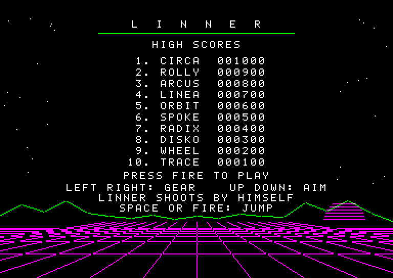
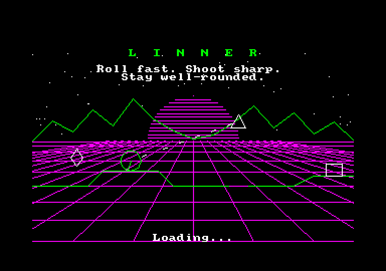
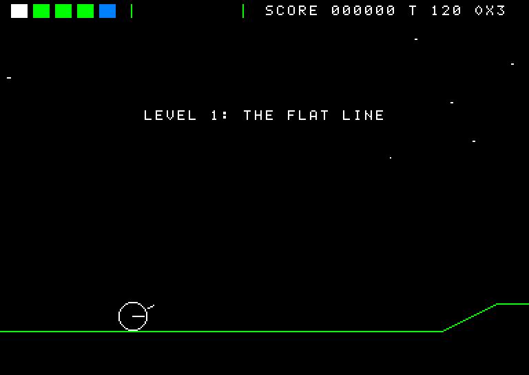
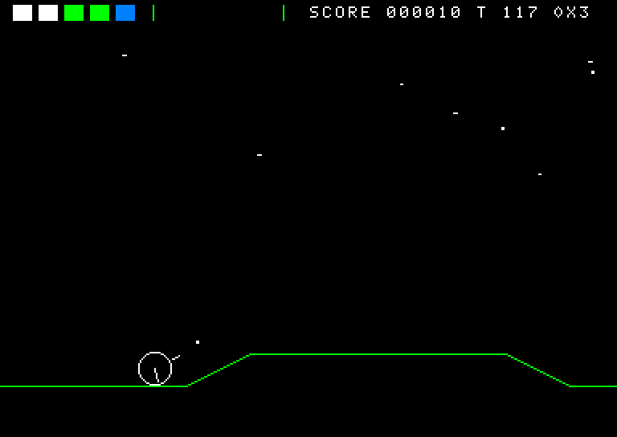
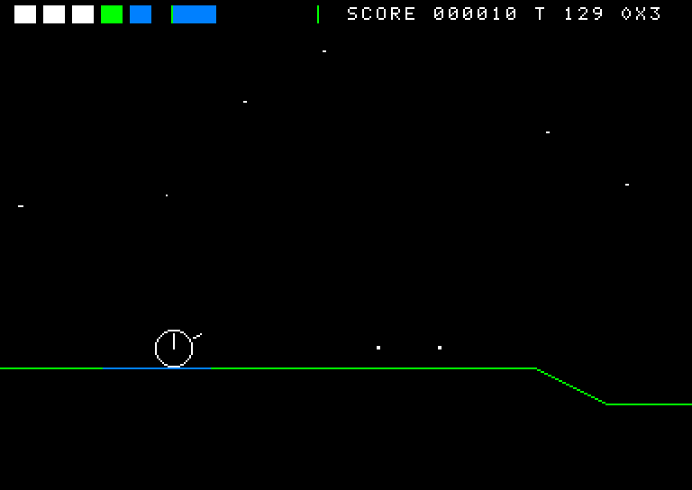
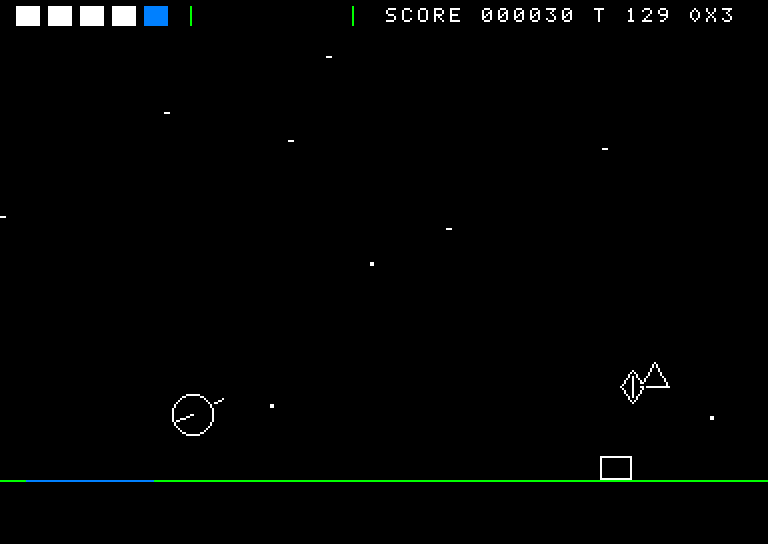
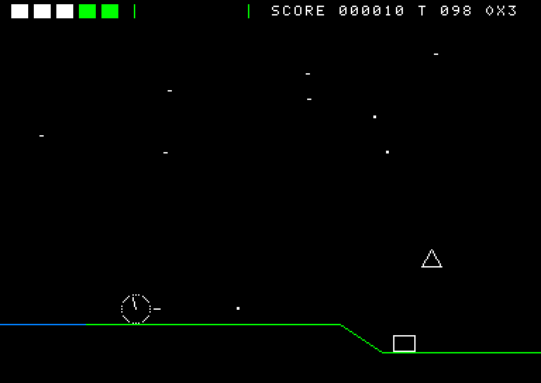
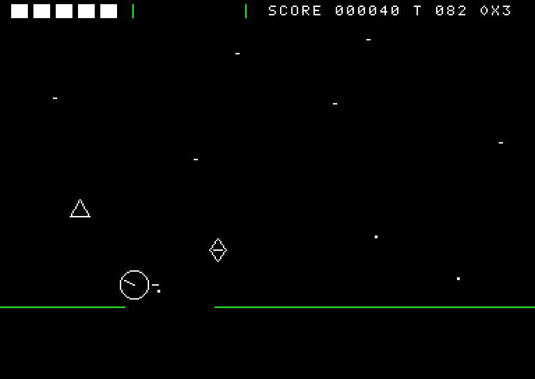
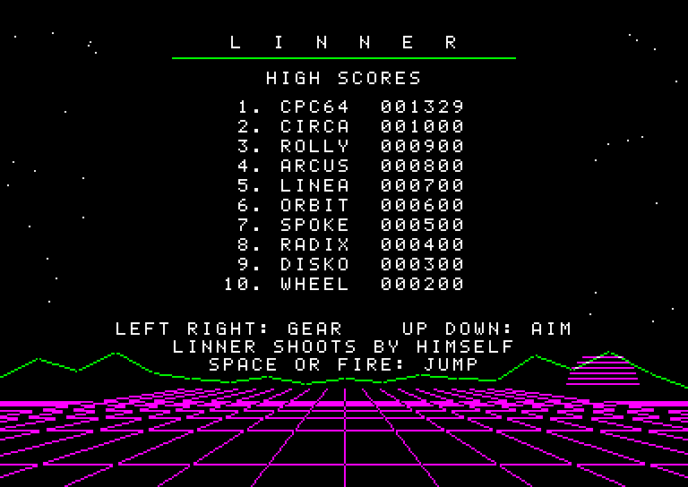
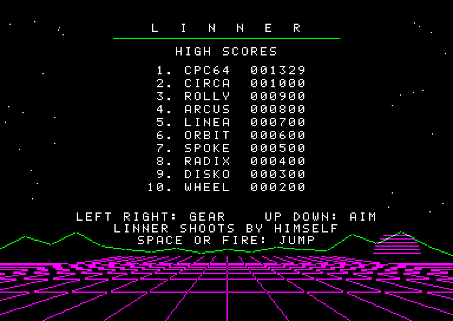

# LINNER — a pointless journey

**Player's manual** · Amstrad CPC 464 / 664 / 6128 · 3" disc

*Roll fast. Shoot sharp. Stay well-rounded.*



## The story

In the single-colour void of the Vectorverse there is only one truth: The
Line. For eons it lay perfectly flat. It was kept that way by the Bureau of
Sharp Angles, a bureaucracy of Rectangles and Triangles who hate two
things: fun, and anything that isn't a polygon.

Then there is **Linner**. Linner is a circle, which makes him a suspect
already. Worse, he has a rebellious ray trapped inside his round body. He
calls it his steering wheel, and it makes him dizzy at speed.

One day Linner looked at the endless flat Line and said: "This is boring.
I want to go *up*." By sheer force of will he bent The Line into hills and
valleys. The Bureau was furious. It sent its enforcers, edgy Triangles and
by-the-book Rectangles. Then it sabotaged The Line itself, with bottomless
chasms and Water Lines. Circles can't swim; they just get soggy.

Linner fights back. By twitching his ray he fires geometric retorts in a
half circle, in strict 10-degree steps: he is still a creature of
mathematics. He has five gears of rolling power. And somewhere along The
Line lie the Rhombus powerups, shiny shapes the Bureau never managed to
classify.

The clock is ticking. Can you guide Linner to the end of The Line, and
etch your name into the magnetic disc of history?

## Loading the game

**From the disc.** Insert the disc and type:

```
RUN"DISC
```

A vector world (The Line, a sunset, a floor running off to the horizon)
is drawn while the game loads, and then the title screen appears. The high score table
is saved on the game disc, so keep the disc writable (write protection
off).

**In an emulator.** Insert `linner.dsk` in drive A and type `RUN"DISC`.
Caprice32 asks whether to save the changed disc when you quit; answer yes
to keep your high scores. You can also use "Save dsk A" from its F1 menu.

**Snapshot.** `linner.sna` starts straight at the title screen. It doesn't
touch the disc, so high scores aren't saved.



## Controls

| Action | Keyboard | Joystick |
|---|---|---|
| Shift gear up (it also goes up by itself every 3 s) | RIGHT | right |
| Shift gear down | LEFT | left |
| Aim the ray up | UP | up |
| Aim the ray down | DOWN | down |
| Jump (hold for a full jump) | SPACE | fire (either button) |
| Start a game (title screen) | SPACE | fire |

Holding UP or DOWN keeps turning the ray. There is no shoot button:
Linner shoots by himself.

## The screen



The top of the screen is the status bar:

- **Gear boxes** (left). Five boxes, lit in white up to the current gear.
  Green boxes are gears you can still shift into. The fifth box is blue
  while gear 5 is locked, and turns green while Max Speed is active.
- **Soggy bar** (between the two green marks). A blue bar that fills while
  Linner rolls through water. When it is full, he sinks.
- **SCORE**, six digits.
- **T**, the seconds left on the level's clock.
- **Lives**: the little circle and the number of lives left.

Each level starts with its name in the middle of the screen. After a
moment it disappears and Linner starts rolling.

## Rolling and gears

Linner always rolls forwards, and he gets faster by himself: **every 3
seconds he shifts up a gear**, up to gear 4 (gear 5 with Max Speed). LEFT
shifts down when you need time, RIGHT shifts up at once; either one starts
the 3 seconds again. Every level and every life starts in gear 1.

| Gear | Speed (pixels per frame) | Full jump covers |
|---|---|---|
| 1 | 1.0 | 40 px |
| 2 | 1.875 | 75 px |
| 3 | 3.0 | 120 px |
| 4 | 4.81 | 192 px |
| 5 | 7.0 | 280 px |

Linner speeds up and slows down gradually, so shift a little before you
need the speed. At the top speeds a busy screen may skip a picture now and
then; the game itself never slows down. The streaks rushing through the sky show how fast he is
going: the higher the gear, the faster and longer they get. **Gear 5 is locked.** Only the Max Speed Rhombus opens it,
for a few seconds (3 to 8, each Rhombus has its own); after that Linner
drops back to gear 4.

## Jumping

Press SPACE (or fire) to jump. **Hold it** for a full jump: 50 rows high and
40 frames long. Release it early for a shorter hop. How far a jump carries
Linner depends on the gear (see the table above).

Linner lands only when he comes down onto the ground from above. If he
falls below the edge of a ledge, he keeps falling. When the ground drops
away under him, at a ledge or the edge of a gap, he falls too.

## Aiming and shooting

The ray inside Linner keeps turning as he rolls. The small tick just
outside his rim shows where he is **aiming**. UP and DOWN turn the aim in
10-degree steps, from straight ahead, through straight up, to straight
behind.

Linner **shoots by himself**: a shot leaves the tick every 8 frames, as
long as fewer than **3 shots** are in flight. A shot flies at 5 pixels a
frame plus Linner's own speed, and stops when it hits a foe, The Line or
the edge of the screen. All you choose is where he aims.

Linner can't shoot downwards. A Rectangle lower down than him has to be
jumped.



## Dangers on The Line

**Gaps.** The Line simply stops. Jump across, with enough speed: the gap
has to be shorter than your jump. Falling off the bottom of the screen
costs a life.

**Water Lines** (blue). Water drags Linner's speed down to almost nothing
and fills the soggy bar. When the bar is full, he sinks and you lose a
life. To cross water:

- cross a short stretch fast;
- jump in late, from the edge, to have less water to roll through;
- or jump the whole stretch.

The bar empties again on dry ground.



**Spikes.** Small triangles on The Line. Touching them costs a life, so
jump them.

## The Bureau of Sharp Angles

**Rectangles** march along The Line, slowly, and turn back at gaps and
water. Shoot them, or jump over them when they are below you.
**10 points.**

**Triangles** drift through the air towards Linner, bobbing up and down,
and always stay above The Line. Shoot them before they reach you.
**15 points.**

Touching any foe costs a life.



## Rhombus powerups

Rhombuses float above The Line. Roll or jump into one to pick it up:
**50 points**. There are two kinds:

- **Max Speed.** Gear 5 is unlocked (the fifth gear box turns green).
  Some chasms can't be jumped without it.
- **Phase Out.** Linner becomes a dotted ghost. Foes, spikes and water
  can't hurt him, but **gaps still can**. The ghost flickers during its
  last second.

Each Rhombus lasts **3 to 8 seconds**; the level decides how long.

Both end when you lose a life.



## Score, time and lives

| | Points |
|---|---|
| Rectangle | 10 |
| Triangle | 15 |
| Rhombus | 50 |
| Each second left at the finish post | 10 |

Each level has a clock (**T** in the status bar). When Linner rolls past
the **finish post**, the seconds left are counted into your score and the
next level begins. If the clock runs out, you lose a life.

You start with **3 lives**. Losing one restarts the level from its
beginning (the score you made stays). After the last life the game is
over. Clear the sixth level and The Line is yours.

## The levels

| # | Name | Length | Time | What's waiting |
|---|---|---|---|---|
| 1 | The Flat Line | 12,012 px | 120 s | Gentle ground, the first foes, puddles and gaps |
| 2 | Swells | 12,904 px | 125 s | Rolling hills and plateaus, Triangles over the crests |
| 3 | Water Lines | 13,799 px | 135 s | The Bureau floods The Line: water and flooded valleys |
| 4 | The Bureau | 14,405 px | 140 s | Rectangles and Triangles everywhere, spikes in between |
| 5 | Chasms | 15,301 px | 95 s | Gaps and ledges for gears 3 and 4, and three chasms only Max Speed clears |
| 6 | End of the Line | 16,802 px | 105 s | Everything the Bureau has, three Max Speed chasms, and a tight clock |

Each level is longer than the one before: about a minute of rolling in
gear 4, more with the slower stretches.



## High scores

The title screen shows the **Top 10**. When a game ends with a score good
enough for it, you can enter a name of 5 characters:

- UP / DOWN choose a character (A–Z, 0–9, `.` `-` `!` and space);
- RIGHT or fire moves to the next character, LEFT goes back;
- fire on the last character finishes.

Or simply type the name on the keyboard: DEL deletes, RETURN or ENTER
finishes. The table is then written to the file HISCORE.DAT on the disc.
If the disc can't be written (write-protected, or no disc), the game says
"COULD NOT SAVE THE TABLE" and keeps the scores until you switch off.
With equal scores, the older entry stays above.

| | |
|:---:|:---:|
|  |  |

## Tips

- Look at the ground ahead: a wide gap needs speed, so let the gears
  climb (or press RIGHT) **before** it; speeding up takes time.
- Gear 4 isn't always best. On busy stretches shift down (LEFT): a lower
  gear gives Linner's shots time to clear the way.
- Aim a little upwards for Triangles. A Rectangle at your level is easy to
  shoot; one below you has to be jumped.
- Jump into water from the edge. The less water Linner rolls through, the
  drier he stays.
- Keep a Phase Out for a stretch full of foes or water, but remember: a
  ghost still falls into gaps.
- A chasm that needs gear 5 always comes after a Max Speed Rhombus: take
  it, shift up at once and jump before the boost runs out.

## Technical notes

- Runs on any CPC with 64K. The firmware is switched off; the game drives
  the µPD765 floppy controller itself to load and save the high score
  table.
- Mode 1 full overscan, 384 × 272 pixels, 50 frames per second, single
  screen buffer: everything is drawn with XOR and only what changed is
  redrawn.
- Written in Z80 assembly (rasm); tested in Caprice32 and CPCEMU.

**Disc contents:** `DISC.BAS` (loader with the loading screen),
`LOADER.BIN`, `LINNER.BIN` (the game), `HISCORE.DAT` (the high score
table).
